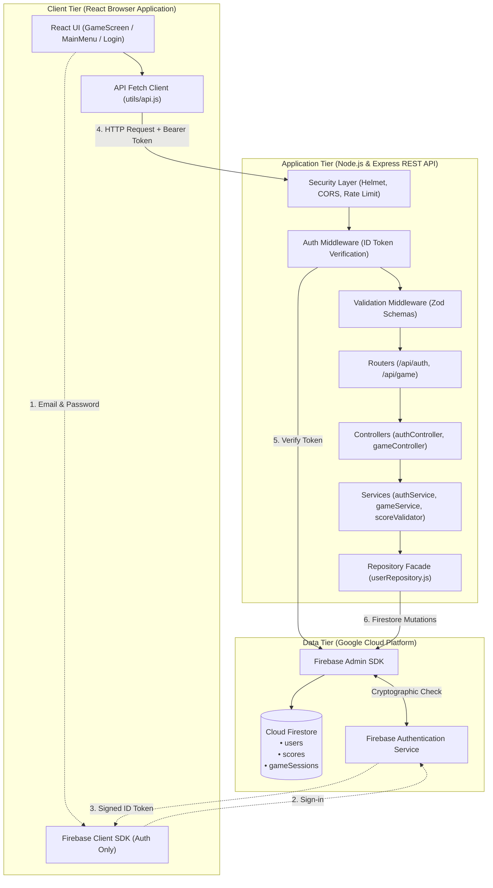
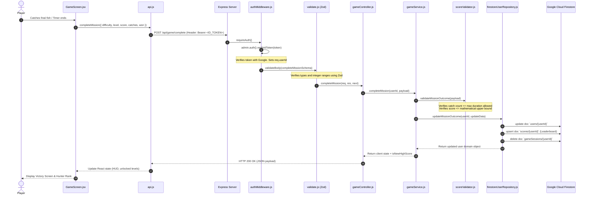
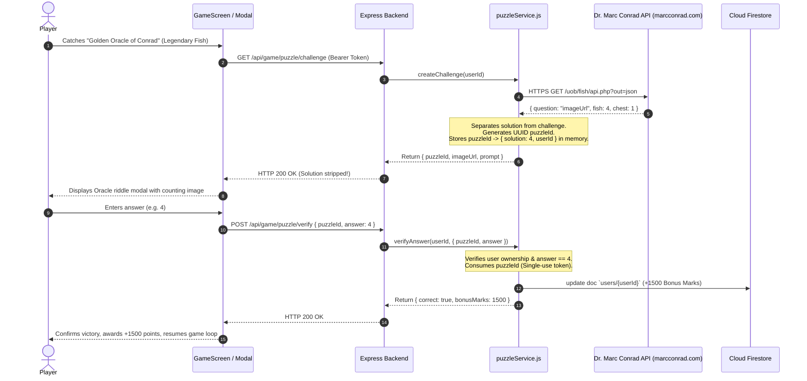

# Fish Catcher Architecture & Request Lifecycle

This document provides a comprehensive technical overview of the Fish Catcher system architecture and walks through the end-to-end lifecycle of a sample request from the React frontend down to Google Cloud Firestore and back.

---

## 1. System Architecture Diagram

---

## 2. Step-by-Step Walkthrough: "Submit a Score"

Here is the exact lifecycle of what happens when a player completes a fishing mission and submits their score:

### Detailed Stage Breakdown:

1. **Trigger (React):** In `GameScreen.jsx`, the mission timer reaches 0 or target marks are reached. React triggers `handleMissionComplete({ difficulty: 'Normal', level: 1, score: 950, catches: 7, won: true })`.
2. **Transport (`utils/api.js`):** Attaches `Authorization: Bearer <ID_TOKEN>` and dispatches a `POST` request to `/api/game/complete`.
3. **Security Headers (`helmet`):** In `app.js`, Helmet attaches `X-Content-Type-Options: nosniff`, `X-Frame-Options: SAMEORIGIN`, and strict CORS policies.
4. **Token Verification (`authMiddleware.js`):** Extracts the Bearer token. Uses `admin.auth().verifyIdToken(token)` via Firebase Admin SDK. Cryptographically verifies that the token was signed by Google, hasn't expired, and belongs to `fishcatcher-60484`. Extracts `decodedToken.uid` into `req.userId`.
5. **Schema Validation (`validate.js`):** Uses Zod to ensure `difficulty` is one of `['Easy', 'Normal', 'Hard']`, `level` is an integer between 1 and 6, and `score` and `catches` are non-negative numbers.
6. **Controller Dispatch (`gameController.js`):** Extracts `req.userId` and invokes `gameService.completeMission`.
7. **Anti-Cheat Validation (`scoreValidator.js`):**
   - Validates that the catch count (7) does not exceed physical limits for Normal mode (60 seconds / 1.5s per catch = 40 max).
   - Validates that the score (950) does not exceed the maximum possible points for 7 catches with pearls and the 1.0x multiplier.
8. **Progression Verification (`gameService.js`):** Checks that the user is currently on Level 1 (cannot submit Level 2 if Level 1 is not unlocked). If `won === true`, advances user's sequential level to Level 2.
9. **Atomic Database Mutation (`firestoreUserRepository.js`):**
   - Updates `users/{userId}` with new level, cumulative catches, and progress map.
   - Upserts `scores/{userId}` with high score and rank title for the public leaderboard.
   - Deletes any paused state in `gameSessions/{userId}`.
10. **Response Flow:** Returns `{ state, isNewHighScore }` with HTTP `200 OK` to the frontend, which unlocks Level 2 on the Main Menu and updates audio and stats.

---

## 3. Third-Party Web Service Interoperability (Marc Conrad Fish Game API)

To satisfy the **Interoperability** theme of the CIS045-3 Distributed Service Architectures unit, the system integrates with an external RESTful web service provided by the University of Bedfordshire:
**Dr. Marc Conrad's Fish Game API** (`https://marcconrad.com/uob/fish/api.php?out=json`).

### Architectural Secure Proxy Pattern
The external web service returns both the question image URL (`question`) and the numerical solution (`fish`). 

> [!CAUTION] Security Risk of Direct Client Calls
> If the browser called Dr. Conrad's API directly, any user inspecting the Network tab in DevTools would immediately see the answer in the JSON response, defeating the riddle challenge.

To preserve game integrity and demonstrate enterprise distributed systems design, our Node.js backend acts as a **Secure Proxy & Challenge Authority**:

